Mình là **sytrong0802**, người đứng sau **ST Shop**, cửa hàng tài khoản AI và Premium. Mình làm web từ giao diện React đến API Laravel và triển khai trên Cloudflare. Ở đây mình chia sẻ những sản phẩm đã làm cùng phần code phía sau.

## Kinh nghiệm làm việc

Hiện mình đang làm việc tại **GINVIFI**. Trước đây, mình từng làm tại **Công ty Truyền thông và Giải trí Eztub** và **Công ty TNHH SOFIN NETWORD**.

## Công nghệ mình thành thạo

Mình dùng **Framer Motion** để tạo chuyển động trên website cá nhân và **next-intl** để tổ chức nội dung tiếng Lào, tiếng Việt cho Japan 2nd Life.

## Dự án chọn lọc

| Dự án | Bên trong có gì? |
| --- | --- |
| **[Website cá nhân ↗](https://github.com/sytrong0802/subnhatrongend)** | Website song ngữ với chuyển động bằng Framer Motion. Phần giao diện dùng Next.js, còn API liên hệ chạy trên Cloudflare. |
| **[Japan 2nd Life ↗](https://github.com/sytrong0802/Japan-2nd-life)** | Cùng một danh mục đồ Nhật đã qua sử dụng được trình bày bằng tiếng Lào và tiếng Việt. Mỗi ngôn ngữ có đường dẫn riêng và có thể triển khai dưới dạng trang tĩnh. |
| **[CS434 ↗](https://github.com/sytrong0802/CS434)** | Đồ án tách giao diện React và backend Laravel thành hai phần trong cùng một repo. |
| **[API thuê xe · CS403 ↗](https://github.com/tainguyenwork9/BE_CS403_G/commit/ecd9d4b)** | Phần mình đóng góp trong dự án nhóm gồm lọc xe theo hãng, loại, tên và giá thuê, cùng tra cứu chi tiết theo mã xe. |

Xem minh họa API thuê xe

## Trao đổi

Bạn muốn trao đổi về một tính năng hoặc góp ý cho dự án? Chọn repo tương ứng ở trên và mở một issue để mình có thể theo dõi cùng đoạn code liên quan.

[Xem tất cả repository của mình ↗](https://github.com/sytrong0802?tab=repositories)
