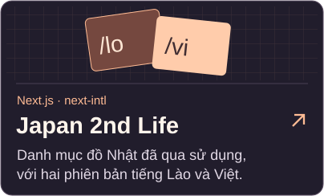
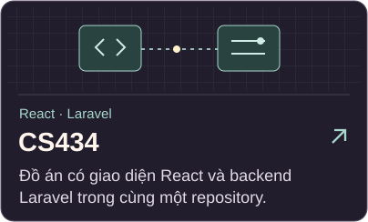
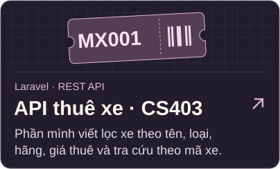

Mình là **Đồng Sỹ Trọng** (@sytrong0802), sinh viên ngành **Công nghệ phần mềm tại Đại học Duy Tân** (khóa 2023–2027). Mình phát triển ứng dụng web và vận hành **ST Shop**, cửa hàng tài khoản AI và Premium. Trước khi làm những dự án React và Laravel ở dưới, mình đã có kinh nghiệm sản xuất nội dung và làm việc trực tiếp với khách hàng.

## Kinh nghiệm làm việc

Hiện mình đang làm việc tại **GINVIFI**. Trước đây, mình từng làm tại **Công ty Truyền thông và Giải trí Eztub** và **Công ty TNHH SOFIN NETWORD**.

- **Vilas · 09/2024–03/2025** — Mình nhập liệu, kiểm tra lỗi và phân chia công việc cho nhóm nội dung. Mình cũng biên tập bài viết, quản lý trang và hỗ trợ SEO cơ bản.
- **Freelance nội dung số · bắt đầu năm 2021** — Mình làm tiếp thị liên kết và triển khai chiến dịch trực tuyến. Google Trends giúp mình tìm chủ đề, còn Canva và CapCut là hai công cụ mình dùng để làm hình ảnh và video.

## Công nghệ mình thành thạo

Xem cách mình dùng các công nghệ này trong dự án thực tế

- **Giao diện song ngữ** · Trong Japan 2nd Life, mình dùng Next.js, TypeScript và `next-intl` để một danh mục sản phẩm có thể phục vụ cả người đọc tiếng Lào lẫn tiếng Việt. Hai phiên bản được xuất thành trang tĩnh ở `/lo` và `/vi`. [Xem mã nguồn](https://github.com/sytrong0802/Japan-2nd-life)
- **Chuyển động và triển khai** · Website cá nhân dùng Framer Motion cho giao diện React, còn OpenNext kết nối ứng dụng Next.js với môi trường triển khai Cloudflare. [Xem website cá nhân trên GitHub](https://github.com/sytrong0802/subnhatrongend)
- **API tìm kiếm** · Với PHP và Laravel, mình xử lý bộ lọc theo hãng, loại và khoảng giá thuê, rồi định dạng mã xe để danh sách và trang chi tiết hiển thị nhất quán. [Xem phần mình đóng góp](https://github.com/tainguyenwork9/BE_CS403_G/commit/ecd9d4b)

## Dự án chọn lọc

  
  
  
  

Xem minh họa API thuê xe

## Trao đổi

Bạn muốn trao đổi về một tính năng hoặc góp ý cho dự án? Chọn repo tương ứng ở trên và mở một issue để mình có thể theo dõi cùng đoạn code liên quan.

[Xem tất cả repository của mình ↗](https://github.com/sytrong0802?tab=repositories)
