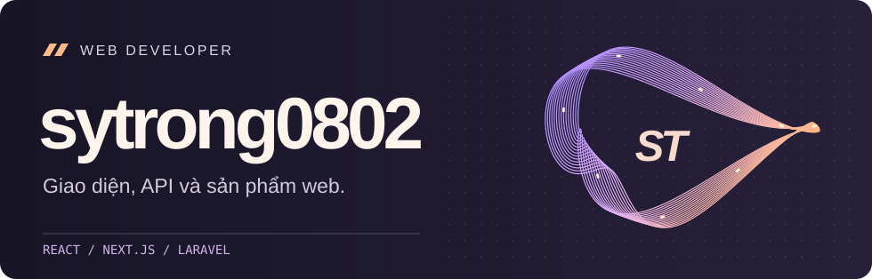
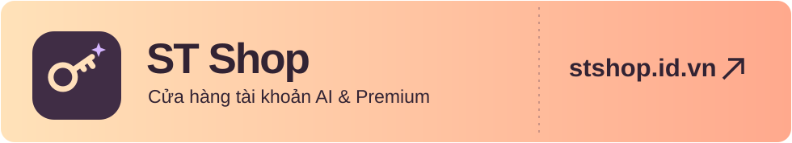
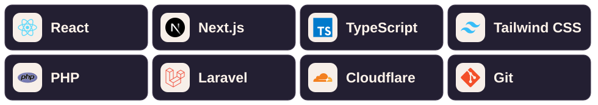
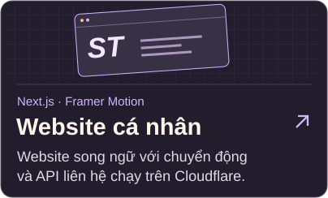

Mình là **sytrong0802**, người đứng sau **ST Shop**, cửa hàng tài khoản AI và Premium. Mình làm web từ giao diện React đến API Laravel và triển khai trên Cloudflare. Ở đây mình chia sẻ những sản phẩm đã làm cùng phần code phía sau.

## Kinh nghiệm làm việc

Hiện mình đang làm việc tại **GINVIFI**. Trước đây, mình từng làm tại **Công ty Truyền thông và Giải trí Eztub** và **Công ty TNHH SOFIN NETWORD**.

## Công nghệ mình thành thạo

Mình dùng **Framer Motion** để tạo chuyển động trên website cá nhân và **next-intl** để tổ chức nội dung tiếng Lào, tiếng Việt cho Japan 2nd Life.

## Dự án chọn lọc

  
  
  
  

Xem minh họa API thuê xe

## Trao đổi

Bạn muốn trao đổi về một tính năng hoặc góp ý cho dự án? Chọn repo tương ứng ở trên và mở một issue để mình có thể theo dõi cùng đoạn code liên quan.

[Xem tất cả repository của mình ↗](https://github.com/sytrong0802?tab=repositories)
