### API tìm xe cho thuê

Trong đồ án nhóm CS403, mình viết phần lọc xe đang sẵn sàng theo tên, loại, hãng và khoảng giá. Khi người dùng mở chi tiết, API nhận mã như `MX001` và trả về thông tin của chiếc xe tương ứng.

[Xem phần code mình đóng góp ↗](https://github.com/tainguyenwork9/BE_CS403_G/commit/ecd9d4b)

Vì sao lại là <code>MX001</code>?

Controller chuyển `MX001` thành số `1` để tra cứu trong cơ sở dữ liệu. Khi trả kết quả, nó thêm tiền tố `MX` và đệm số thành ít nhất ba chữ số để danh sách và trang chi tiết cùng hiển thị một kiểu mã xe.

### Dự án web

| Dự án | Điểm đáng xem |
| --- | --- |
| [Japan 2nd Life ↗](https://github.com/sytrong0802/Japan-2nd-life) | Cửa hàng đồ Nhật đã qua sử dụng có hai phiên bản tiếng Lào và tiếng Việt. Next.js xuất trang tĩnh cho từng ngôn ngữ. |
| [Website cá nhân ↗](https://github.com/sytrong0802/subnhatrongend) | Website song ngữ dùng React và Framer Motion cho phần chuyển động, có API liên hệ và cấu hình triển khai lên Cloudflare. |
| [CS434 ↗](https://github.com/sytrong0802/CS434) | Mã nguồn đồ án chia thành hai phần để dễ theo dõi từ giao diện React đến backend Laravel. |
